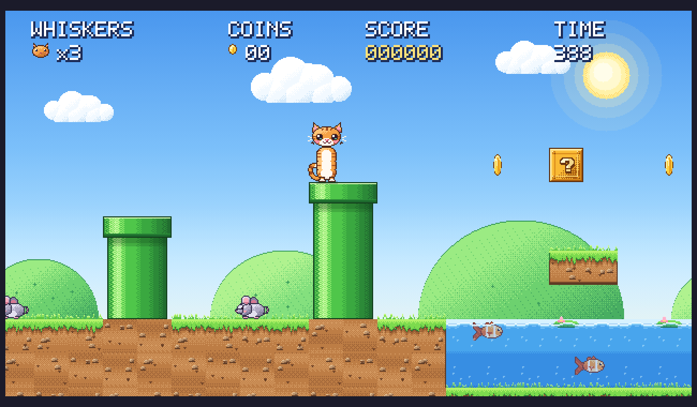

# Super Whiskers

A Super Mario Bros–style platformer starring Whiskers the cat. Plain HTML5 Canvas and
JavaScript — no build step, no dependencies, no asset files. All pixel art and audio
are generated in code at load time.

**Play it:** https://wukath.github.io/super-whiskers/

## Controls

| Action | Keys |
| --- | --- |
| Move | Arrow keys / WASD |
| Jump (hold for higher) | Space / Z / Up |
| Run + throw yarn | Shift / X |
| Pounce dash | C / L |
| Ground pound | Down while in the air |
| Enter a warp pipe | Down while standing on it |
| Wall jump | Push into a wall while falling, then jump |
| Pause / mute | P / M |
| Start at a level | 1 / 2 / 3 on the title screen |

## Levels

1. **Meadow** — grassy intro with a secret bonus cave through the warp pipe.
2. **Crystal Caves** — underground: wall-jump shaft, falling platforms, a wall you must pounce through.
3. **Sunset Shore** — beach at dusk, mostly water crossings on logs and islands.

Power-ups: fish snack (grow), ball of yarn (throw bouncing yarn balls), star (invincible),
milk carton (1-up, hidden in invisible blocks).

## Running locally

Open `index.html` in a browser. That's it.

## Layout

- `js/pixel.js` — pixel painter, sprite cache, bitmap font
- `js/sprites.js`, `js/sprites_extra.js` — pixel maps and animation frames
- `js/tiles.js` — tiles, blocks, pipes, water, themed backgrounds
- `js/level.js` — level definitions and parser
- `js/entities.js` — player physics, enemies, items, platforms, effects
- `js/audio.js` — synthesized sound effects and music
- `js/game.js` — game loop, camera, HUD, states
