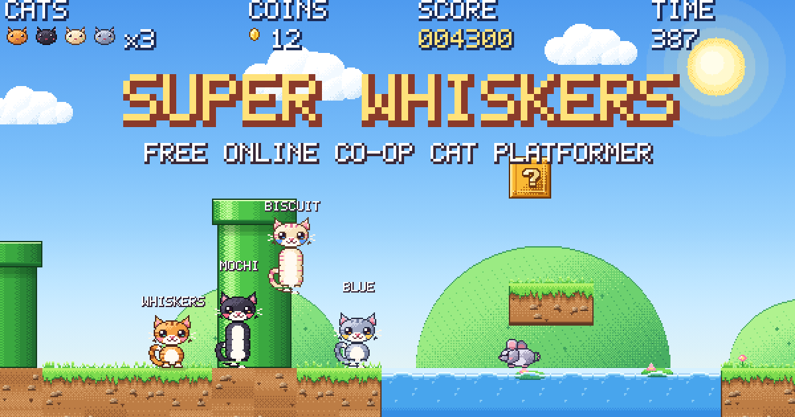
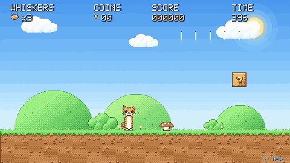
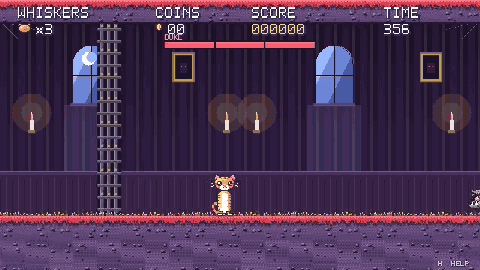

# Super Whiskers

A Super Mario Bros–style platformer starring Whiskers the cat. Plain HTML5 Canvas and
JavaScript — no build step, no dependencies, no asset files. All pixel art and audio
are generated in code at load time.

**Play it:** https://wukath.github.io/super-whiskers/

 

## Online co-op

Press **O** on the title screen to host a room; friends press **J** and type the 4-letter
code, or open the `?room=CODE` link shown in the lobby. Up to four cats (Whiskers, Mochi,
Biscuit, Blue — pick with ←/→ in the lobby). The host's browser runs the game and streams
state to the others over WebRTC (PeerJS), so there is no game server. Lives, coins and
score are shared; a cat that dies floats back as a bubble that a teammate can pop; warp
pipes and the flag take everyone along.

## Controls

| Action | Keys |
| --- | --- |
| Move | Arrow keys / WASD |
| Jump (hold for higher) | Space / Z / Up |
| Run + throw yarn | Shift / X |
| Pounce dash | C / L |
| Duck / crawl | Down on the ground |
| Ground pound | Down while in the air |
| Enter a warp pipe | Down while standing on it |
| Wall jump | Push into a wall while falling, then jump |
| Pause / mute | P / M |
| Start at a level | 1 – 5 on the title screen |
| Host / join online | O / J on the title screen |

## Levels

1. **Meadow** — grassy intro with a secret bonus cave through the warp pipe.
2. **Crystal Caves** — underground: wall-jump shaft, falling platforms, a wall you must pounce through.
3. **Sunset Shore** — beach at dusk, mostly water crossings on logs and islands.
4. **Midtown Rush** — New York at night. Dodge or ride yellow cabs, wall-jump up fire
   escapes to the rooftops, ride an elevated train (duck under the signals), surf steam
   vents over open manholes. Rats, swooping pigeons and lid-throwing raccoons.
5. **Evil Mansion** — a haunted house with trapdoors, chandelier lifts and a flooded cellar,
   ending in a locked arena where **Duke** the bulldog waits. Stomp his head three times
   (yarn balls and pounces chip him too) while he charges, slams and lobs bones.

Power-ups: fish snack (grow), ball of yarn (throw bouncing yarn balls), star (invincible),
milk carton (1-up, hidden in invisible blocks).

## Running locally

Open `index.html` in a browser. That's it.

## Layout

- `js/pixel.js` — pixel painter, sprite cache, bitmap font
- `js/sprites.js`, `js/sprites_extra.js`, `js/sprites_boss.js`, `js/sprites_city.js` — pixel maps and animation frames
- `js/tiles.js` — tiles, blocks, pipes, water, themed backgrounds
- `js/level.js` — level definitions and parser
- `js/entities.js` — player physics, enemies, items, platforms, effects
- `js/audio.js` — synthesized sound effects and music
- `js/net.js` — PeerJS room hosting/joining
- `js/game.js` — game loop, camera, HUD, states, co-op and netcode
